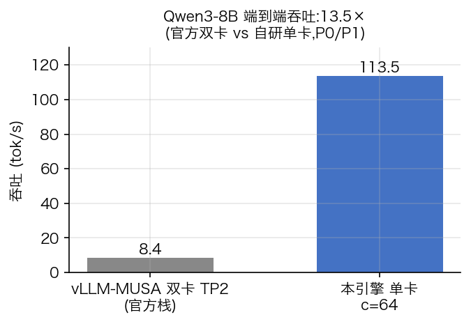
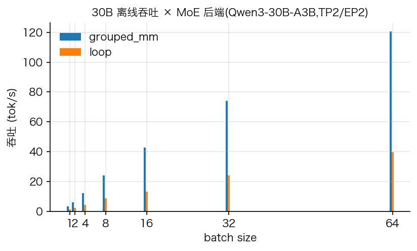
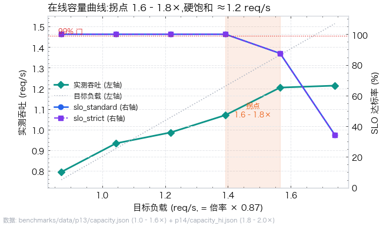
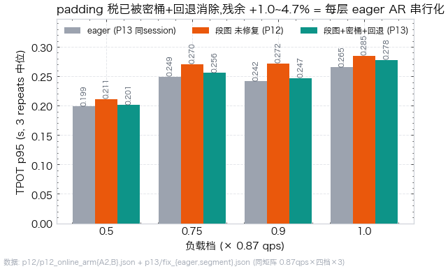
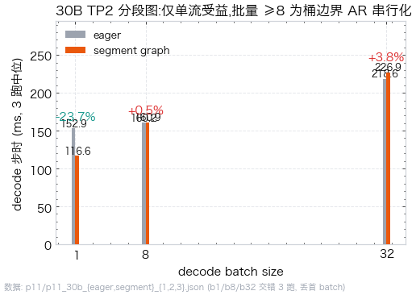
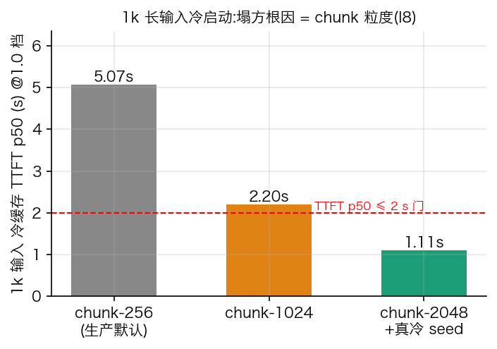

<div align="center">

</div>

<div align="center">


</div>

面向国产 GPU（摩尔线程 MTT S4000 / MUSA 全栈）的 **Qwen3-30B-A3B 双卡 MoE 推理引擎**：TP2/EP2、自研 Triton paged attention、stall-free 混批调度、OpenAI 兼容流式服务，并以**预注册冻结门的 A/B 方法**完成 14 轮性能/正确性判决。

> 引擎底座参考了 MIT 协议的轻量推理引擎 nano-vllm（~1.4k 行，[docs/upstream-readme.md](docs/upstream-readme.md)）；MUSA 适配、MoE 模型支持、调度/服务化与全部平台能力为本项目实现，上游版权声明见 [LICENSE](LICENSE)。

---

## ✨ 结果一览

> 以下图表由 [`scripts/render_metrics.py`](scripts/render_metrics.py) 从 `benchmarks/data/` 的证据 JSON 程序化生成——每个数字都有对照、冻结门与 sha256 存档，负结果与正结果同等呈现。

| 端到端加速（8B 基线） | 30B 离线吞吐 × MoE 后端 |
|---|---|
|  |  |

**在线容量曲线**（拐点 1.6–1.8×，硬饱和 ≈1.2 req/s，1.0× 档双口径 SLO 100%）：

<p align="center">

</p>

**分段图的完整闭环**——离线单流 −23.7%，在线被桶 padding 税否决（+5.9~14.7%），密桶+回退修复后 padding 税消除（0.9 档 +14.7%→+2.3%）、残余为桶边界 AR 串行化，最终按预注册门关闭、定格单流开关：

| 在线 TPOT p95 分档 | 30B 离线 decode 步时 |
|---|---|
|  |  |

**1k 长输入：冷缓存塌方根因 = chunk 粒度**（chunk-2048 冷态 TTFT p50 1.08–1.12 s 过 ≤2 s 门）：

<p align="center">

</p>

---

## 🎯 项目定位

面向摩尔线程 S4000（**无 FP8 算力、MUSA 闭源生态**）的四件事：

1. **MUSA 适配**：把引擎从 CUDA 生态移植到 torch_musa + MCCL + Triton-mtgpu；
2. **MoE 模型支持**：新增 Qwen3-MoE（30B-A3B）模型实现，含 FP8 量化权重反量化加载；
3. **MoE 加速与调度**：packed expert + MUSA grouped GEMM、TP2+EP2、stall-free mixed prefill/decode；
4. **可观测服务**：请求级 TTFT/TPOT 指标、可复现 benchmark、OpenAI 兼容流式 API。

| 项 | 配置 |
|---|---|
| GPU | 2× MTT S4000（48GB / 卡，PCIe Gen5 x16） |
| 软件栈 | torch 2.11 + torch_musa 2.11、MCCL 2.11、Triton（mtgpu backend）、Ubuntu 22.04 |
| 目标模型 | Qwen/Qwen3-30B-A3B-Instruct-2507-FP8（30.5B 总参 / 3.3B 激活，128 专家 top-8） |

## 🏗️ 架构

```
├── nanovllm/            # 引擎本体（Python 包名沿用底座）
│   ├── engine/          # LLMEngine / Scheduler / ModelRunner / BlockManager
│   ├── models/          # qwen3_moe.py（本项目,Qwen3-MoE TP2/EP2）
│   ├── layers/          # attention(自研 Triton paged) / linear / layernorm / rope / sampler
│   └── ...
├── docs/                # 交接 / 计划 / 问题台账 / 架构 / 调研
├── benchmarks/          # 当前轮报告;历史轮次在 benchmarks/archive/
└── scripts/             # 压测 / 基准 / 决策 / 图表脚本;一次性实验脚本在 scripts/archive/
```

详细设计见 [docs/architecture.md](docs/architecture.md);当前迭代计划见 [docs/PLAN.md](docs/PLAN.md);问题台账见 [docs/ISSUES.md](docs/ISSUES.md) 与 [docs/CLOSEOUT.md](docs/CLOSEOUT.md)。

<details>
<summary><b>📈 当前进度（P0–P15 全部判决完毕 — 点击展开）</b></summary>

| 阶段 | 状态 | 关键数字 |
|---|---|---|
| P0–P1 基线与 MUSA 移植 | 完成 | vllm-musa 8.4 tok/s → 自研引擎单卡 113.5 tok/s(b64);首 token 与 HF 100% 对齐 |
| P2–P2e MoE 双卡 + 优化 | 完成 | 30B TP2+EP2 packed experts + grouped_mm 比 loop 快 3.0–3.2×;离线 b32 133 tok/s、b64 141 tok/s |
| P3–P4 调度与服务化 | 完成 | stall-free 混步调度;OpenAI 兼容 SSE API;短 prompt 四档 Poisson ×3 全 100% SLO(std+strict) |
| P5–P6 指标/后端/长上下文 | 完成 | 指标 v3(双 SLO/Wilson CI);**triton_paged 按五层门转正**(TPOT p95 −12~18%);I8 长上下文重测 + 调度三缺口修复 |
| P7–P9 优化探索 | 完成 | 投机解码 NO-GO(α≈0);I19 因果链否定(~20–30 ms/步未解释固定等待);整图否决(I29,TP2 replay 楔死);chunk-2048 把 1k TTFT 砍 −69~73%(50% 档 1.036 s、SLO 100%) |
| P10–P12 分段图与在线判定 | 完成 | 分段图(图内零 MCCL)离线 30B b1 **−23.7%**、768 图/rank 零失败、跨臂逐位 0 翻转;**在线 A/B 判定 FAIL**(并发 14–30 撞桶 padding 税,慢 5.9–14.7%,同 session 复跑确认)→ 不转正、默认维持 eager |
| P13 硬骨头攻坚 | 完成 | **I30 关闭**(同 session ABA:现树快于 pre-P8 栈 23–51%);**I33 修复验证并关闭分支**(密桶 1056 图零失败 + pad 回退,padding 税证实并消除 0.9 档 +14.7%→+2.3%,残余 AR 串行化 +4.7% 超门 → 段图定格单流开关);**I8 闭合**(冷缓存塌=chunk 粒度);**容量下界 1.070 req/s** |
| P14 收官补测 | 完成 | `--prompt-seed-per-repeat` 根治暖缓存伪象;I12 exit 看门狗;**容量拐点 1.6–1.8×、硬饱和 ≈1.2 req/s**;1k 冷态 1.0 档 chunk-2048 过 TTFT 门(1.08–1.12 s);I29 官方线索(MCCL 混用,缓解非修复) |
| P15 autotune + PD 分离 | 完成 | E1 kernel autotune 内核 **1.59–2.90×**(数值门 FAIL→默认不翻,opt-in);I29 新栈维持(init 楔+驱动级残留);**PD 分离单机双卡全闭环**:M1/M2 bitwise 交接 + **在线 A/B ITL p95 −16~25%、client e2e −41~48%**(吞吐换延迟,实测验证);新发现 I34(token 依赖引擎状态历史) |

正确性门:tiny TP1/TP2 × loop/grouped/bmm 六配置逐 token 全等;跨后端比较采用"候选确定性 + 五层等价门"(数值契约见 [docs/numerics-policy.md](docs/numerics-policy.md))。历史轮次报告(P0–P14)在 [benchmarks/archive/](benchmarks/archive/),当前轮在 [benchmarks/](benchmarks/)。

</details>

## 🚀 快速开始

```bash
pip install -e .
python example.py
```

MUSA 环境各阶段运行方式见仓库内运行手册(本地维护)。

双卡正确性回归(按顺序,任何一步失败都不要往下跑性能;均在服务器跑,tiny 模型在 `/tmp/tiny_moe`):

```bash
PYTHONPATH=. python3 tests/p2_grouped_mm.py       # TP1/TP2 × loop/grouped/fused + round_robin + 重复确定性(六配置全等 rc=0)
PYTHONPATH=. python3 tests/p6_bmm_dense_tiny.py   # bmm_dense decode 后端六配置全等
python3 -m pytest tests/test_benchmarking_v3.py   # 压测客户端单测 15/15
PYTHONPATH=. python3 tests/p8_scheduler_gaps.py   # 调度缺口单测 6/6
```

消融 benchmark(模型只加载一次,进程内切换后端;先跑正确性门再测性能):

```bash
PYTHONPATH=. python3 scripts/p2_benchmark.py \
  --batches 1,2,4,8,16,32,64 --prompt-len 128 --output-len 32 --repeats 3 \
  --moe-backends loop,grouped_mm --scheduler-policy fcfs \
  --verify-prompts --reference-outputs benchmarks/p2-reference-8tok.json \
  --output benchmarks/data/p2_ablation_full.json
```

OpenAI 兼容服务与开放环压测：

```bash
pip install -e '.[serve]'
# 生产栈必须显式带 --decode-moe-backend bmm_dense:该参数默认跟随 --moe-backend(grouped_mm),
# 漏掉则 decode 跑在 grouped_mm 上,不是本项目的生产配置(见 docs/ISSUES.md I32)。
PYTHONPATH=. python3 -m nanovllm.entrypoints.openai.api_server \
  --model /root/autodl-tmp/models/Qwen3-30B-A3B-Instruct-2507-FP8 \
  --served-model-name qwen3-30b-a3b --scheduler-policy stall_free \
  --decode-moe-backend bmm_dense

PYTHONPATH=. python3 scripts/benchmark_online.py --model qwen3-30b-a3b \
  --max-qps 0.93 --requests 32 --max-tokens 64 --fractions 0.25,0.5,0.75,1.0 \
  --output benchmarks/data/online.json
```

## 🧪 评测方法

- **预注册冻结门**：每个实验先写判据/容差/判定树再跑，跑完不改阈值（见 [docs/PLAN.md](docs/PLAN.md)）；
- **五字段报告**：门 / 口径 / 结果 / 判定 / 证据——判定只有 PASS、FAIL、未产出三种，缺数据不出判定；
- **同 session A/B**：两臂相邻测量；跨时段必须补同 session 复现臂；交错取中位数、CV ≤ 5% 否则 INVALID；
- **负结果照录**：投机解码 NO-GO、整图否决、分段图在线否决等 7 项负结果全部留档（[docs/CLOSEOUT.md](docs/CLOSEOUT.md)）。

## 📄 License

MIT（底座沿用上游，版权声明见 [LICENSE](LICENSE)）
