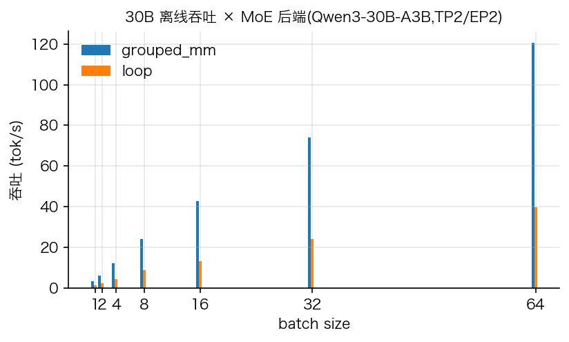
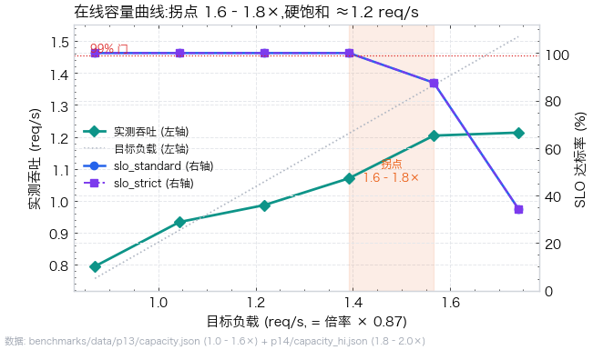
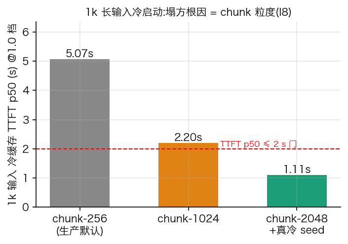
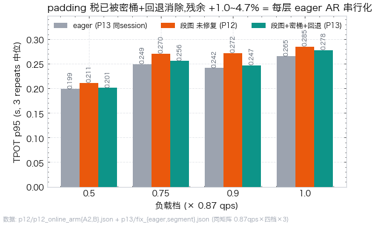

# 性能与实验证据

> **这一页是开发/审计资料，不是部署前置，也不构成 SLA。** 产品安装/启动见 [DEPLOY.md](DEPLOY.md)，开发回归见 [DEVELOPMENT.md](DEVELOPMENT.md)。

本仓库早期是围绕“预注册冻结门”的 A/B 实验台：每个性能改动先写判据再跑，负结果保留。那些报告仍在 [benchmarks/](../benchmarks/) 与 [benchmarks/archive/](../benchmarks/archive/)；本页只做索引和口径说明，不把历史数字包装成产品承诺。

## 1. 口径边界

- 负载与压测客户端是自建的，不是第三方标准 trace；客户端有 28 个单测，schema 版本化。
- 证据来自单一环境（2×S4000 租用实例）；对比基线为 vllm-musa 0.29.1（2026-10-25 同栈同卡实测）。
- 冻结门解决“自己骗自己”，不等价于第三方验证；标准 ShareGPT 类 trace 交叉对账是已知未做项。
- 引用加速比时请连同基线版本、日期、负载口径一起引；不同报告的 b64 数字可能不同口径。

## 2. 历史报告入口

- [benchmarks/README.md](../benchmarks/README.md)：报告目录与统一测量方法。
- [docs/HANDOFF.md](HANDOFF.md)：当前状态、已判决清单、P0–P26 速览。
- [docs/PLAN.md](PLAN.md)：冻结门与轮次计划。
- [docs/ISSUES.md](ISSUES.md)：技术/生态问题台账（含负结果）。
- [docs/CLOSEOUT.md](CLOSEOUT.md)：收官清单（已解决/无法解决/需用户）。
- [docs/P25-review.md](P25-review.md)：代码审查与平台边界。
- [docs/engine-vs-vllm-sglang.md](engine-vs-vllm-sglang.md)：历史能力对标（非产品承诺）。

## 3. 图表（历史口径）

以下图由 `scripts/render_metrics.py` 从 `benchmarks/data/` 的证据 JSON 生成；`benchmarks/data/` 不入库，新 clone 不能直接重渲，需先跑相应 measurement。

| 离线吞吐 | 在线容量 |
|---|---|
|  |  |

| 长上下文 TTFT | TPOT 分档 |
|---|---|
|  |  |

更多图（baseline/segstep）与每轮报告在 `assets/charts/`、`benchmarks/`。

## 4. 如何复现实验

见 [DEVELOPMENT.md](DEVELOPMENT.md) 的“性能/对比实验”。注意：实验脚本只应在维护/审计时运行，不是部署步骤；`tests/run_regression.sh` 也不是服务启动前置。

## 5. 已知负结果（摘要）

- MUSA Graph replay：TP2 引擎级间歇楔死（I29），生产默认 eager。
- KV int8：机制正确、质量门连续 FAIL（I20），不作为默认。
- 投机解码：实测 α≈0 且 c=0.39，NO-GO。
- 分段图：离线单流收益但在线 A/B FAIL，只留单流开关。
- 厂商算子：`torch._grouped_mm` 不可捕获、mp22 数值错误、watchdog 不可配，各有绕过。

细节与证据见 HANDOFF/ISSUES/CLOSEOUT 和 `benchmarks/`；产品只承诺 [DEPLOY.md](DEPLOY.md) 描述的启动/API 行为，不承诺这些实验数字。